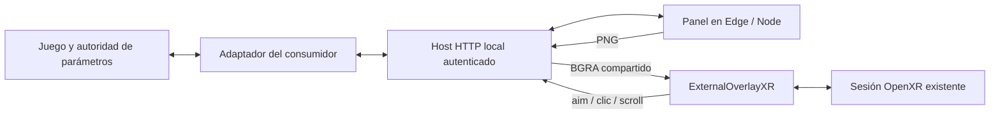

# Arquitectura, límites de responsabilidad y flujo de datos

## Tres piezas necesarias

`ExternalOverlayXR.dll` es una API layer OpenXR. Se incorpora a la cadena existente de la aplicación, conserva sus llamadas y añade el panel/cursor al frame cuando corresponde. No implementa DLSS, no detecta ejecutables por nombre y no contiene offsets UEVR. Observa sistema/runtime/perfiles de interacción y rectángulos de proyección.

El **host** es un proceso auxiliar fuera del juego. Aloja un servidor HTTP loopback, comparte píxeles/eventos con la DLL y ejecuta un navegador Edge sin ventana visible mediante Node/Playwright. Python/Pillow decodifica las capturas PNG y las convierte a BGRA. Separar estos procesos evita introducir el navegador y su entorno de scripts dentro del proceso de render del juego. El host no es otra sesión VR.

El **panel** es la interfaz HTML/JavaScript que se dibuja en ese navegador: botones, opciones, sliders, Log e información. Los widgets comunes no conocen el juego. Su adaptador web y transporte conectan las opciones con la autoridad del mod. El proyecto consumidor controla qué parámetros existen y cómo se aplican.

## De un clic al cambio real

1. La aplicación sincroniza sus acciones. La capa añade sus action sets según visibilidad y estado, respetando los originales.
2. La capa localiza el aim derecho en espacio VIEW, calcula intersección con el panel y publica eventos de movimiento/pulsación en el ring.
3. Node consulta `/xr/input`, transforma esos eventos a eventos DOM del navegador y mantiene el orden down/up.
4. El widget modifica un borrador local; aún no escribe el motor.
5. Apply captura la sesión y la revisión base, comprueba los grupos y envía una solicitud validada al adaptador.
6. El adaptador aplica en el punto autorizado por su motor y publica selección/confirmación. El host no inventa confirmación a partir de HTTP 200.
7. El panel presenta el nuevo estado. La capa observa por separado las vistas que la aplicación realmente presenta.

## De la interfaz al visor

El navegador produce una imagen 672×720. El host la publica en el área visible de una superficie BGRA 960×900. El resto es reservado; el cursor nativo ocupa una región propia del mismo atlas. La capa sube los píxeles a un swapchain propio y añade uno o dos quads. El cursor actualiza su pose por frame OpenXR, por lo que no depende de la frecuencia de capturas del navegador. El panel se sitúa a 1,5 m, con ancho 0,84 m, alto 0,9 m y desplazamiento horizontal −0,08 m.

El frame original, las identidades de sus capas y sus imágenes se conservan. No convertir un callback de UI en una afirmación de acceso pre-TAA a la escena. El procesamiento de render permanece en el consumidor.

## Dependencia entre repositorios

AC7 conserva una instantánea de las fuentes iniciales y consume la DLL aceptada por huella. Este nuevo repositorio es la base de evolución común; extraerlo no reemplaza silenciosamente lo instalado en AC7. Cada integración debe fijar una versión, huella del binario y versión de ABI. No usar descargas `latest` automáticas.

La integración vigente AC7 0.8.5-r2 consume ExternalOverlayXR 0.1.1 con su
huella exacta y fue aceptada por Carlos. Su arranque automático relativo al
perfil pertenece al bridge del consumidor. La evolución 0.1.1 conserva los
contratos de composición/entrada del común; ver [compatibilidad](COMPATIBILITY.md).

Las mejoras de perfiles/entrada se realizan aquí y se adoptan expresamente en cada consumidor. Las opciones de un motor, referencias de memoria, archivos de configuración propios y permisos para recrear recursos se resuelven en su adaptador. Un cambio de ABI requiere estrategia compatible y pruebas de versiones cruzadas; no basta con renombrar el ZIP.
