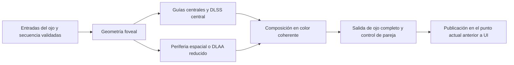

# Viabilidad 0.9.4: foveación integrada y auditoría DLSS5

**Estado posterior al estudio, 11 de octubre de 2026:** piloto 0.9.4 implementado, verificado en laboratorio e instalado. Carlos amplía el requisito 11 a Quest 3 con Meta Quest Link OpenXR, además de Pimax/Pimax OpenXR y Quest 3/VDXR. La sección 21 recoge la revisión del candidato existente y la matriz de aceptación pendiente. Los párrafos de propuesta y «todavía sin implementar» de las secciones 1–19 conservan el estado histórico del análisis; la implementación se documenta en la sección 20 y en `ENTREGA_0.9.4.md`.

**Fecha de consulta: 11 de octubre de 2026. Resultado: viable como desarrollo propio, con dificultad alta en el renderer y validación estéreo obligatoria.** La integración completa para BL3 es un objetivo razonable; todavía no está implementada ni demuestra ahorro o calidad. Recomiendo conservar la base 0.9.3 y desarrollar por etapas verificables dentro del piloto.

**Alcance vigente, revisado el 11 de octubre:** Carlos limita 0.9.4 a **foveación fija**, en **Pimax con Pimax OpenXR** y **Quest 3 con VDXR**. Se mantienen el indicador **cuadrado / círculo** y la sección independiente de UEVR **`DLSS_FOVEADO`**. El módulo debe ser **exportable a otros proyectos**, con núcleo, backend y adaptadores separados. Seguimiento ocular e interfaz del Layer estándar quedan para versiones posteriores. La sección 12 conserva investigación ocular futura; las secciones 13–19 definen el diseño actualizado. Esta revisión modifica el análisis y los requisitos; todavía no hay implementación.

## 1. Conclusión y decisiones

Podemos integrar en nuestra arquitectura el procesamiento central, la periferia, la composición y sus controles. Ya disponemos de color, profundidad y movimiento privados por región, del contexto D3D11 y de un punto de sustitución anterior a la UI. Eso evita depender de que otro plugin descubra nuestras llamadas NGX. Una integración completa sigue usando el runtime NVIDIA: no implica reimplementar el modelo neuronal propietario.

La ruta recomendada es **un módulo propio reutilizable de foveación, conectado al renderer mediante un adaptador B3**, con especificación matemática, código y shaders propios. Incorporar código GPL de Cheeky a la DLL distribuida obligaría a revisar la política de fuentes privadas; conservar esa política requiere evitar esa incorporación o conseguir una licencia alternativa adecuada. No basta con renombrar código o ponerlo en otra DLL. La lectura de fuentes realizada para este estudio tampoco acredita un proceso de desarrollo independiente por sí sola: la futura procedencia de cada componente debe quedar documentada. [Licencia de Cheeky](https://github.com/ClarkCheekyKent/CheekyFoveatedDLSS/blob/v0.5.5/LICENSE), especialmente secciones 5 y 6.

Las alternativas son:

| Ruta | Encaje técnico | Decisión |
|---|---|---|
| Implementación propia en B3 | Control directo de datos, historiales y UI; trabajo de renderer importante | Recomendada |
| Incorporación de fuentes Cheeky | Reduce parte del trabajo genérico, pero cambia obligaciones de distribución y conserva mucha complejidad multijuego | No compatible con mantener sin cambios nuestra política privada |
| Licencia alternativa del autor | Podría permitir reutilización; depende del permiso y de los derechos de los componentes concretos | Posibilidad, no concedida ni solicitada |
| Envolver el plugin externo | Mantiene hooks, capa global y problema de correspondencia con nuestro renderer | No satisface lo pedido |

La GPL permite estudiar y modificar privadamente; el punto aquí es la futura distribución del mod integrado. Esta evaluación usa el texto de licencia publicado y no presupone permisos adicionales.

## 2. Base real y evidencia examinada

El encabezado histórico de AGENTS menciona 0.9.2. `ESTADO_ACTUAL.md`, `REQUISITOS_0.9.3.md`, CMake y la huella instalada sitúan la base actual en **0.9.3**. No he cambiado AGENTS ni el estado operativo durante el estudio.

| Elemento | Identidad comprobada |
|---|---|
| DLL instalada | `C0CCBE91752A9462907D4F647C9A9F483FF17141F17A3F766ADB0EDE8B084A4E` |
| Runtime instalado | `B3-0.9.3-3b6366d32d9c` |
| Perfil publicado 0.9.3, según recibo vigente | `C2AAAA57C40D87E0203D357CC6CCF8F39F22491D0CBE2414947A38FC3C3077F3` |
| UEVR requerido | Nightly 01143, `4ee5c6b6162dee2291fc75f9dfc57667f6d45a2d` |
| Backend UEVR fijado | `1A34CF65E4C12002EC967ED167DDDA4E1CC7AE1DA82157D0E279597BEDDEED75` |
| Equipo observado mediante nvidia-smi | RTX 5060 Ti, controlador 616.64; observación de este PC, no requisito universal |
| Cheeky estudiado | v0.5.5, publicado 05/10/2026, commit `4e47eefe51a512dcaf76bbdc672dcdab5251fc71` |
| Referencia temporal privada | AC7 R37 fijado en `f69a0fa16e7b6219e44049c3d0ae76cc1f69ad9b`, sin modificar la referencia |

Todas las lecturas del perfil instalado se hicieron mediante el alias UNC de `config/baseline.json`. Se revisaron las fuentes activas, contratos de rectángulos, recibos actuales, incidente Neural y el relato registrado de la prueba Cheeky. Se descargaron fuentes y dos ZIP públicos exclusivamente para comparar contenidos sin ejecutarlos.

**No se ha compilado, instalado, arrancado/inyectado/capturado un juego, cambiado configuración, actualizado un driver ni publicado nada.** Las comprobaciones del estudio son estáticas, de versiones y de hashes. La aceptación anterior de DLSS no se extiende a esta foveación, a DLAA/Neural ni a nuevos FPS.

## 3. Funcionalidad que hay que reproducir

Cheeky procesa una región con mayor calidad y recompone la imagen con una periferia más barata. No hace que el motor deje de renderizar geometría, iluminación o sombras fuera del centro. Sus controles incluyen área/forma, transición, AA periférico, supersampling central y centro fijo o por mirada; también ofrece NR regional antes/después del reescalado. [Referencia de controles](https://github.com/ClarkCheekyKent/CheekyFoveatedDLSS/blob/v0.5.5/USAGE.md).

| Función | Situación en B3 | Viabilidad / condición |
|---|---|---|
| SR solo en la región central | No existe recorte foveal dentro de cada región temporal | Alta, con nuevas texturas/contratos de recorte |
| Periferia barata sin DLAA | No hay compositor centro/periferia | Alta; calidad temporal periférica a comprobar |
| DLAA periférico con resolución propia | Backend limitado a una feature por región | Media-alta; ampliar contextos y permitir DLAA LDR privado |
| Modelo diferente en centro/periferia | Selector actual admite default/J/K/L/M | Ampliar por capacidad; no ofrecer E sin validarlo |
| Anchura, altura, desplazamiento y transición | UI y protocolo existentes reutilizables | Alta |
| Forma rectangular/elíptica | Falta máscara de composición | Alta; cambiar máscara no reduce por sí solo el trabajo rectangular NGX |
| Supersampling central | Salida actual ligada al tamaño final | Media-alta; salida central mayor y reducción posterior |
| Alineación binocular automática fija | API UEVR expone proyecciones; falta demostrar asociación física completa | Media; puerta crítica para calidad |
| Foveación fija en ambos visores | Hay entradas por ojo; falta la integración foveada | Alcance 0.9.4: Pimax/Pimax OpenXR y Quest 3/VDXR, con geometría propia de cada configuración |
| Mirada real con Pimax OpenXR | API integrada no expone directamente un contrato de gaze | Versión futura por decisión de Carlos; no condiciona la aceptación de 0.9.4 |
| Mirada simulada y pérdida de seguimiento | No existe | Investigación futura; ahora solo reservar el contrato de colocación |
| NR foveado antes/después de SR | Hay NR de ojo completo, porcentaje y orden | Media-alta; ampliar geometría e IPC, mantener recibos por ojo |
| Área NR enlazada o independiente | No existe | Viable después de probar un centro común correcto |
| Diagnóstico de área/ojos y tiempos GPU | Evidencia actual insuficiente para ahorro foveado | Necesario en el piloto |
| Vulkan, D3D12 nativo, OpenVR/LibOVR, RR, AFW | Arquitecturas ajenas a este BL3 D3D11 fijado | No transferir compatibilidad de Cheeky a B3 |

No se considera “integración completa” una UI que conserve el trabajo a pantalla completa y simplemente oculte una parte del resultado. El presupuesto NGX central debe reducirse de verdad. En la ruta D3D11 de Cheeky se crean features privadas con las dimensiones recortadas; desplazar una subregión de salida de una feature del tamaño original no basta. [Backend D3D11](https://github.com/ClarkCheekyKent/CheekyFoveatedDLSS/blob/v0.5.5/src/d3d11_backend.cpp).

La periferia con DLAA puede implicar procesar **todo el ojo a menor resolución**, usando solo su parte visible al componer. No debe modelarse automáticamente como un anillo que cuesta proporcionalmente solo a su área. [Implementación periférica](https://github.com/ClarkCheekyKent/CheekyFoveatedDLSS/blob/v0.5.5/src/d3d11_peripheral_dlaa.cpp).

## 4. Encaje en nuestras fuentes

| Componente actual | Ventaja y cambio necesario |
|---|---|
| `native/temporal/GuideBuilder.h` | Ya produce profundidad y MV privados; añadir recortes sin alterar el cálculo de cámara sobre el viewport original |
| `TemporalView.h` / `ScenePass.h` | Mantener validación de atlas, regiones, secuencia, cámara y discontinuidad; añadir geometría foveal como contrato separado |
| `TemporalProcessor.h` | Dos ojos, un propietario global, reset/recibos; admitir contextos distintos para centro y periferia sin crear otro propietario del mismo backend |
| `native/imported/ac7_r37/third_party/rt_neural/Neural.cpp` | `Generation` tiene `std::array<Eye,2>`, salida y configuración comunes; preparar una derivación B3 con al menos cuatro features/historias si se usa DLAA periférico |
| `TemporalRoute.h` | Coordina etapas y recuperación de pareja; integrar composición y fallos antes de publicar, manteniendo restauración conjunta |
| `SceneOutputReplacement.h` | Publicación en el punto ya controlado; conservar tamaño y correspondencia del ojo completo |
| `PrivateNeuralHost.h`, `NeuralSession.h`, `neural_host/*` | Transporte privado D3D11/D3D12 con proceso por ojo; ampliar entradas regionales, límites, órdenes y recibos |
| `native/control/PanelController.h`, `B3_DLSS.lua`, `PanelScript.h` | Conservar el panel actual; nuevo controlador y script independiente `DLSS_FOVEADO`, coordinado con los ajustes del renderer |
| `native/overlay/adapter/Bridge.cpp`, `native/overlay/web/*` | Sin nuevos controles en esta fase; futuro adaptador del mismo controlador para el Layer estándar |
| Nuevo módulo exportable / adaptador B3 | Separar contratos, geometría, composición y backend de captura BL3, UEVR y empaquetado; sin proveedor ocular en 0.9.4 |
| Empaquetado/manifiestos/verificador | Nuevos contratos y pruebas sobre el candidato exacto; conservar perfil completo y bootstrap del overlay |

Hay restricciones concretas que impiden resolverlo con unos sliders: hoy `TemporalProcessor::Validate` exige DLAA HDR a tamaño nativo o SR LDR reducido. El DLAA periférico sobre color LDR no cumple ese contrato. Además, el preset E de Cheeky queda fuera del rango actual aceptado. Ambas ampliaciones deben ser explícitas y comprobadas; no relajar guardas generales para que una prueba pase.

No se deben modificar las fuentes importadas como si siguieran byte a byte idénticas al origen. La evolución debe tener procedencia y diff B3 reconocibles. AC7 y ExternalOverlayXR de referencia permanecen intactos.

## 5. Arquitectura propuesta



La generación de ajustes se fija al comienzo de la pareja. El centro/periferia de ambos ojos usa esa generación; los sliders no pueden cambiar un ojo antes que el otro. Preparar recursos fuera de la evaluación crítica y usar un conjunto limitado de tamaños evita recreaciones mientras se arrastra. Aplicar al soltar o con botón Aplicar.

**Coordenadas.** Mantener tres espacios distintos: atlas BL3, ojo completo y recorte. Primero calcular/decodificar las guías con la proyección del ojo completo; después extraer el recorte. Sustituir el viewport original por el tamaño del recorte al reconstruir movimiento de cámara cambiaría su semántica. Se debe conservar la rejilla de muestreo al convertir entrada/salida, incluyendo redondeo y medio texel. Ojos con un píxel de diferencia requieren sus propios cálculos.

**Movimiento.** Nuestras guías expresan desplazamiento anterior menos actual en píxeles de entrada. Para un recorte móvil, la transformación geométrica derivada es `MV_local = MV_escena + origen_actual - origen_anterior`, en las mismas unidades. El jitter conserva su significado en píxeles de entrada; no se multiplica sin más por la fracción de área. Redimensionar una guía exige transformar magnitud y muestreo, sin mezclar velocidades de objetos distintos en sus bordes. Resets por salto, cambio de tamaño o discontinuidad deben tratar todos los historiales afectados.

**Composición.** Separar color codificado y lineal de acuerdo con nuestra conversión actual. Centro, periferia y residual NR deben compartir semántica antes de mezclarse. Proteger alfa, límites del ojo, HUD, manos y outlines; la máscara visible necesita margen de reconstrucción para no exponer un borde sin historia. Probar bordes duros antes de suavizarlos: una transición ancha puede ocultar un error de coordenadas sin corregirlo.

**Recuperación.** Si falla cualquier rama, no publicar una combinación de ojo/fotograma/generación incompatible. Aprovechar el rollback existente y definir qué imagen válida se conserva. No prometer un fallback instantáneo a DLSS normal si su feature no está preparada: mantener features de reserva aumenta VRAM; volver por el estado original controlado puede necesitar preparación. Instrumentar esa transición y sus dos ojos.

**Alineación.** Dos regiones en un atlas y `cameraId = base + región` no demuestran por sí solos cuál llega a cada ojo físico. Contrastar matrices de vista con las proyecciones UEVR y validar la correspondencia hasta la presentación en una futura prueba binocular. Proyectar una dirección común con las proyecciones de cada ojo permite plantear alineación fija sin instalar la capa global de Cheeky. Es una propuesta, pendiente de resolver asimetría/cant y de demostrar el recorrido completo. Si hay ambigüedad, desactivar foveación y explicar el motivo. Cheeky dedica una capa y calibración propias a este problema. [Calibración upstream](https://github.com/ClarkCheekyKent/CheekyFoveatedDLSS/blob/v0.5.5/EYE-CALIBRATION.md).

**Centro fijo ahora; mirada después.** 0.9.4 usa una colocación fija por ojo, calculada con su geometría real y ajustable mediante el menú. No requiere extensiones oculares ni una nueva capa OpenXR. El núcleo recibe una colocación explícita mediante un contrato versionado que podrá alimentar un proveedor de mirada futuro. El problema de habilitación temprana estudiado en la sección 12 se conserva para esa ampliación; no se implementa como infraestructura inactiva en este piloto. [Contrato ocular de referencia futura](https://github.com/KhronosGroup/OpenXR-Docs/blob/main/specification/sources/chapters/extensions/ext/ext_eye_gaze_interaction.adoc).

**Neural.** Mantener procesos/historias separados por ojo y el protocolo privado. En Before, producir una imagen de entrada completa con el residual Neural regional compuesto y después aplicar SR/periferia; en After, aplicar el recorte Neural al resultado compuesto. Ambas variantes requieren guías y escalas correspondientes, además de margen por contexto del modelo. Si centro NR y SR difieren, convertir desde el mismo centro físico, no compartir offsets de distinto espacio. Evitar escalar dos veces por accidente mediante nuestra preparación y Cost Scaler. El mínimo actual superior a 64 píxeles por eje continúa: los recortes pequeños no deben reabrir el caso bloqueante de 64×64.

## 6. Pixelación del ojo izquierdo

Hecho registrado: aparece con área SR recortada y desaparece a área completa o con SR foveation desactivada. No hay en lo revisado una captura correlacionada con crops, buffers y evaluación de ambos ojos que determine la causa.

| Hipótesis, sin confirmar | Por qué merece prueba | Evidencia que la distingue |
|---|---|---|
| Asociación de región DLSS y ojo equivocada/inestable | El síntoma es asimétrico | Identidad persistente, proyección y patrón distinto por ojo antes/después de presentación |
| Origen/escala de recorte o composición erróneos | Depende del área | Cuadrícula por ojo; entradas/salida con origen conocido; rectángulos impares y bordes |
| MV/depth incorrectos para subregión | Recorte cambia coordenadas temporales | Movimiento analítico y residual de reproyección; pruebas estáticas y en movimiento |
| Historial compartido, reutilizado o reseteado desigual | Puede afectar solo una rama | Feature/epoch/frame/origen/reset por contexto, cargas y alternancia de ajustes |
| Interacción entre hooks, texturas privadas y correspondencia XR | Hay dos integraciones buscando/gestionando DLSS | Comparación controlada del pipeline propio y su telemetría |
| Vista sRGB, recurso o subrecurso incorrecto | Puede simular bloques/contraste | Formatos efectivos y muestreo de patrón uniforme, sin otro cambio |

No hay base para atribuirlo a NVIDIA, UEVR o Cheeky con certeza. El piloto propio elimina una capa de interacción y permite observar el contrato, pero podría reproducir el mismo error matemático si se implementa mal. No se presenta como corrección demostrada.

## 7. UI sencilla dentro del mod

Crear una **entrada independiente `DLSS_FOVEADO` en el menú de UEVR**, usando su API de paneles de scripts. Hereda tamaño, anclaje, orientación, visibilidad y navegación del menú UEVR; no requiere otra ventana. El panel `NVIDIA_DLSS` conserva sus ajustes generales. No se añade una página al navegador ni al Layer estándar en 0.9.4. Se proponen etiquetas inglesas coherentes con el panel existente, conservando siempre el título literal elegido por Carlos. Diagnóstico/bordes apagados por defecto; controles avanzados contraíbles.

| Vista básica | Comportamiento propuesto |
|---|---|
| Off / Conservative / Balanced / Performance / Custom | Perfiles propios de foveación, claramente diferenciados de DLSS Quality/Balanced |
| Center: Fixed | Centro configurable por ojo; sin selector ocular operativo en esta versión |
| Central area | Tamaño enlazado; en avanzado se separan ancho y alto |
| Peripheral quality | Spatial / Temporal; muestra escala efectiva |
| Soft transition | Ajusta borde sin cambiar la resolución global |
| Show region; Square / Circle | Indicador de la región fija efectiva en ambos ojos |
| Apply / Restore / Save at startup | Reutiliza confirmación real del renderer y persistencia privada |

Avanzado: anchura/altura, desplazamiento fijo, transición, preset central/periférico, escala periférica, supersampling central y controles de región Neural enlazada/independiente. No mostrar controles de suavizado/pérdida ocular ni un selector que aparente seguimiento disponible. La futura versión añadirá ese selector utilizando el mismo contrato de colocación. Las capacidades de procesamiento no disponibles se explican.

Puntos iniciales **propuestos, sin aceptación visual ni rendimiento**: Conservative 75×70 %, Balanced 65×60 %, Performance 55×45 % de las dimensiones del ojo, supersampling 1× y transición inicialmente moderada. El preset de publicación seguirá Off hasta completar validación. Los límites técnicos se calculan en píxeles, por runtime y modo, antes de aceptar cada petición; no se fijan por copiar los mínimos de Cheeky. Una región al 55×45 % ocupa aproximadamente 24,75 % del rectángulo, no 55 % del trabajo completo.

El estado debe distinguir solicitada, aplicada y guardada e informar tamaño real por ojo, centro fijo efectivo, recuperación del renderer, modo de periferia y tiempo GPU. No llamar “activo” al simple hecho de enviar una orden a Lua/NGX. La ausencia de seguimiento ocular no es una advertencia en un modo exclusivamente fijo.

## 8. Rendimiento esperable: qué se puede afirmar

La ganancia se concentra en inferencia DLSS/NR y sus recursos. No reduce automáticamente el render de la escena, CPU del motor o coste del compositor VR. Copias, preparación, dos features auxiliares, composición y sincronización pueden consumir el ahorro. Los porcentajes anunciados para otros juegos no son una predicción para BL3.

Modelo de presupuesto, **no benchmark**:

`T_nuevo = T_escena + T_guías + T_centro + T_periferia + T_composición + T_transporte_NR + T_NR_regional + T_sincronización`

La comparación debe usar el camino equivalente sin NR cuando NR está apagado. En particular, no atribuir a foveación un ahorro obtenido al bajar también la resolución global o la intensidad Neural.

Un cálculo de píxeles ayuda a detectar configuraciones absurdas. Con escala render `r`, escala periférica relativa al render `p`, fracciones centrales `w,h` y supersampling central `s`, un indicador aproximado es `w*h*s² + (r*p)²` si el DLAA periférico procesa todo el ojo reducido. Para `r=.58,p=.75,w=.55,h=.45,s=1`, resulta `.436725` respecto al área de salida. **No significa un ahorro temporal del 56,3 %**: algoritmos, modelos, overhead y memoria son distintos. Subir a `s=1.5` eleva el indicador a `.7461`.

Medir timestamps GPU por etapa, memoria incremental y tiempos CPU de espera; invalidar muestras disjoint. Medir además tiempo real de frame del juego y reproyección por separado. El temporizador de un helper que presenta una ventana auxiliar no sirve como FPS del juego. Por ese motivo, el gobernador FPS genérico de Cost Scaler debe permanecer desactivado hasta disponer de una autoridad temporal apropiada para VR.

## 9. Auditoría de DLSS y DLSS5 a fecha del estudio

**Respuesta: la parte principal está bastante al día; no toda la integración coincide con las últimas fuentes genéricas.** Se han comparado archivos instalados, inputs del proyecto y paquetes remotos. “Última” se limita a la publicación verificable en cada canal consultado.

| Capa | Nuestra identidad | Último público consultado | Resultado |
|---|---|---|---|
| SDK NGX / DLSS SR | Directorio SDK 310.9.1 en CMake; DLL 310.9.1.0 firmada por NVIDIA | NVIDIA DLSS 310.9.1, 08/09/2026 | Al día con release pública consultada |
| Streamline | No es la autoridad de nuestra ruta directa NGX; el host fuerza NGX-only | Streamline 2.14.1, 08/09/2026 | No hay un simple Streamline que debamos actualizar para arreglar NR |
| Complemento NR | `renodx-dlss5.addon64`, banner 8.5.0-rc10 | 8.5.0-rc10 en RHI, 26/09/2026 | **Hash idéntico**, ambos ojos |
| Modelo NR real | PE 310.8.3.0 en `nvngx_dlssnr_real.dll` | Paquete comunitario `310.8.Lecram` en RHI | **Hash idéntico**, ambos ojos; etiqueta de paquete y versión PE son distintas |
| Proxy NR | Derivación propia AC7/B3 de Cost Scaler, sin versión PE | Cost Scaler 1.0.6, 13/09/2026 | No idéntico; conserva adaptaciones obligatorias. Headers de shaders compilados y ABI compartida coinciden con v1.0.6 |
| Helper Feeder | Derivado fijado R37 más protocolo BL3 `0xB3120001` | Feeder 1.19.0, **11/10/2026** | Hay cambios upstream; no sustituible como ejecutable |
| ReShade privado del helper | 6.8.0.2155 / producto 6.8.0 | Web oficial: 6.8.0, 02/08/2026 | Coincide la versión de producto; no se comparó el binario con una descarga nueva |
| Cheeky usado como referencia | v0.5.5 | Latest v0.5.5, 05/10/2026 | Se estudió la misma versión del intento externo |

Fuentes de versiones: [NVIDIA DLSS](https://github.com/NVIDIA/DLSS/releases/tag/v310.9.1), [Streamline](https://github.com/NVIDIA-RTX/Streamline/releases/tag/v2.14.1), [RenoDX en RHI](https://github.com/RankFTW/rhi-repo/releases/tag/renodx-dlss5-8.5.0-rc10), [modelo Lecram](https://github.com/RankFTW/rhi-repo/releases/tag/dlssnr-310.8.Lecram), [Cost Scaler](https://github.com/xenmods/DLSSNR-Cost-Scaler/releases/tag/v1.0.6), [Feeder](https://github.com/jlrouzies-fr/DLSS5-Feeder/releases/tag/v1.19.0), [ReShade](https://reshade.me/).

### Oficial no equivale a nuestra integración oficial

NVIDIA ya presenta DLSS5 como tecnología disponible en NBA 2K27 para RTX 50; no es correcto describirlo en general como algo inexistente u únicamente filtrado. Sin embargo, eso no convierte nuestra ruta BL3 en integración oficial. [Anuncio NVIDIA](https://www.nvidia.com/en-us/geforce/news/dlss-5-3d-guided-neural-rendering/).

Los árboles públicos completos consultados de NVIDIA/DLSS v310.9.1 y Streamline v2.14.1 no contienen rutas `dlssnr`/`neuralrender` ni una guía/plugin NR pública equivalente a SR/RR/FG. El portal público sigue describiendo el paquete UE como DLSS 4.5, SL 2.14.1 / NGX 310.9.1. **No he localizado un SDK público NR listo para sustituir nuestro camino**, ni he comprobado accesos de partners. No afirmar que NVIDIA carezca de SDK privado. [Portal de desarrollo](https://developer.nvidia.com/rtx/dlss), árboles guardados en los recibos.

El modelo oficial usa color, movimiento y estado temporal; la aplicación conserva control artístico. Su estabilidad declarada no certifica un recorte regional, dos ojos de UEVR ni las guías particulares de un mod. [Descripción de investigación de NVIDIA](https://research.nvidia.com/labs/adlr/DLSS5/).

El SR local tiene firma Authenticode válida. El modelo Lecram local conserva metadatos NVIDIA pero devuelve **HashMismatch**, y coincide exactamente con el paquete modificado de RHI. No se debe llamar “DLL NVIDIA intacta/firmada válida”. Esto identifica su naturaleza comunitaria, no prueba por sí solo una avería. RHI es un catálogo/mirror, no el fabricante ni garantía del último build del Discord del autor.

### Qué actualizar selectivamente

**Feeder:** el diff del host fijado frente a 1.19.0 tiene 28 adiciones/19 eliminaciones, algunas explicadas por nuestras adaptaciones. Upstream aporta diagnósticos NGX y búsqueda en la carpeta superior. Las novedades globales incluyen helper para juegos de 64 bits, avisos de depth/MSAA y OpenGL; nuestro BL3 ya dispone de helper propio y guías del motor. No importarlas en bloque ni tratar esas novedades como una corrección probada de sombras o pixelación. Mantener duración real de frame, preset solicitado, heaps privados, protocolo/recibos y aislamiento de dependencias. La búsqueda ampliada de DLL puede ser indeseable en un bundle fijado.

**Cost Scaler:** `proxy_main.cpp` difiere por monitor ABI2, controles artísticos y guardas de errores/tamaños. Sustituirlo eliminaría confirmaciones que usa nuestra ruta. `Downsample_Shader.h`, `Resolve_Shader.h`, `dlssnr_shared.h` y headers NGX comparados son idénticos a v1.0.6. El HLSL textual conservado sí difiere considerablemente: **es una discrepancia de procedencia/reconstrucción a resolver**, no evidencia de que el binario esté usando esos shaders antiguos, puesto que el C++ incluye los headers compilados. Verificar el vínculo fuentes-bytecode antes de desarrollar el nuevo compositor.

**Parámetros Neural:** nuestra UI denomina los estilos Balanced/Sharp/Cinematic y permite intensidad hasta 200 %. Cheeky documenta Standard/Natural/Cinematic e intensidad normalizada a 0–1. Eso señala una discrepancia semántica a auditar con el runtime/consumer fijados; no demuestra por sí solo que nuestros valores sean la causa de un defecto. El nuevo piloto debe comprobar rangos y significado antes de copiar nombres, normalizar valores guardados o prometer que un control tiene efecto. Preservar la configuración hasta esa decisión.

### Otras rutas comunitarias

| Solución consultada | Diferencia relevante | Aplicación a B3 |
|---|---|---|
| Deep Fried Chicken | Consumidor alternativo que el Feeder documenta; distribución del autor en Discord | No he verificado su última versión del canal. Requeriría adaptar/validar nuestro contrato; no instalar junto con RenoDX |
| wilsjo2 OptiScaler NR 0.8.91 prerelease | Añade previsualización de compresión espacial de la periferia; ruta NR/PreSR/multipass | Otra arquitectura, no un upgrade directo de nuestro helper ni equivalente a recortar SR |
| Dagherbou OptiScaler NR | Publicaciones v0.2.0-dlssnr y v0.2.0-patch1 prerelease | Alternativa de consumidor; la numeración no se compara con RenoDX |
| NIGos dlss5-bridge | Lista consultada encabezada por v1.4.13-pre8 | Puente genérico; nuestro transporte ya es propio y debe preservar guías/estéreo |
| neural-upstream v0.3.0 | Gestión temporal de NR; documenta correcciones de cadencia, descriptores y reconstrucción | Su reutilización temporal no equivale a nuestro Before ni acredita estabilidad binocular en B3 |
| Swappers/instaladores y forks de empaquetado | Distribuyen o configuran varios componentes | Un número más alto del instalador no implica modelo neuronal más nuevo |

[Feeder y consumidores](https://github.com/jlrouzies-fr/DLSS5-Feeder/blob/v1.19.0/README.md), [wilsjo2 0.8.91](https://github.com/wilsjo2/OptiScaler-DLSSNR-PreSR-Multipass/releases/tag/v0.8.91), [Dagherbou](https://github.com/Dagherbou/OptiScaler_DLSSNR/releases), [NIGos](https://github.com/NIGos/dlss5-bridge/releases), [neural-upstream](https://github.com/matiasLombo/neural-upstream/releases/tag/v0.3.0).

Las nightlies generales de `clshortfuse/renodx` consultadas incluyen `renodx-dlssfix`; ese archivo no es `renodx-dlss5`. Su fecha más reciente no acredita una actualización del consumidor NR instalado. No se ha exhaustivamente auditado cada fork ni los canales privados de Discord; la evidencia permite declarar identidad con el catálogo público consultado, no “el último binario de todo internet”.

## 10. Desarrollo y puertas del piloto

| Etapa propuesta | Resultado revisable | Condición para avanzar |
|---|---|---|
| A. Contratos y procedencia | Módulo exportable, adaptador B3, configuración/colocación versionadas; resolver HLSL/bytecode | Construcción aislada y sin dependencias BL3/UEVR en el núcleo; base recuperable y procedencia correcta |
| B. Foveación SR fija | Centro real, periferia, composición, UI y diagnóstico por ojo | Patrones sintéticos y ambos ojos correctos; Off conserva ruta aceptada |
| C. Periferia temporal y supersampling | Historial por ojo/rama y presets disponibles | NVIDIA evalúa contrato; memoria y coste de pipeline medidos |
| D. Foveación Neural | Before/After, regiones enlazadas/independientes y parámetros efectivos | Feature18/recibos, tamaños, composición y estabilidad por ojo |
| E. Dos visores y reutilización | Foveación fija Pimax/Pimax OpenXR y Quest 3/VDXR; consumidor independiente del módulo | Geometría binocular y controles comprobados en ambos; módulo utilizable fuera del árbol B3 |
| F. Integración y entrega | Controles simples, recuperación y perfil completo | Prueba del ZIP exacto más aceptación física autorizada del alcance fijo |

B/C permiten decidir pronto si el mecanismo compensa en BL3. D permanece dentro del alcance: Carlos ha aplazado el seguimiento ocular, no las funciones de SR/NR fijo. **La foveación fija completa y validada en ambos visores sí puede cerrar 0.9.4.** No se exige soporte ocular. La exportabilidad del módulo es un requisito de arquitectura y validación; no implica entregar otros juegos ya integrados. RR/AFW, D3D12/Vulkan y compatibilidad multijuego automática no son capacidades implícitas.

No asigno una fecha de entrega fiable antes de B: se trata de cambiar contextos, sincronización, geometría y composición, no solo UI. Aplazar mirada elimina su proveedor y los problemas del recorte móvil continuo; permanecen el trabajo de periferia temporal, Neural regional y modularización.

### Validación necesaria, aún no ejecutada

1. **CPU:** redondeo, límites, atlas con padding, origen derecho, un píxel entre ojos, máscaras, cambios de tamaño y reset; conversiones de movimiento por recorte con oráculos analíticos.
2. **GPU sintética:** cuadrículas distintas por ojo, bordes y valores HDR/LDR, alfa, formato/vistas, no contaminación entre ojos; movimiento de cámara y objetos, disoclusiones, recortes móviles. WARP demuestra geometría/composición, no inferencia NVIDIA.
3. **GPU NVIDIA:** creación/evaluación reales de cada feature, resultado NGX, dimensiones efectivas, restauración de bindings, recreación, memoria y tiempos; fallos inducidos del segundo ojo y de cada rama. No trasladar resultados de otra DLL.
4. **Comparación de rutas:** Off, área completa, centro reducido, periferia temporal on/off, supersampling; SR normal y NR Before/After; validar que el mismo modo y resolución global se mantienen en A/B.
5. **Prueba física coordinada, cuando Carlos la autorice:** cubrir Pimax/Pimax OpenXR y Quest 3/VDXR con diagnóstico binocular, centro/bordes fijos, movimiento de cabeza/objetos, partículas/armas/HUD/outlines, cargas y cambio de resolución. Incluir el caso exacto que pixelaba el ojo izquierdo. Agrupar parámetros por visor; no confundir ambos ojos correctos en uno con aceptación en los dos visores.
6. **Cierre:** verificador formal del candidato, hashes, copia de recuperación y archivos ajenos intactos. Importación/carga del `Borderlands3.zip` completo en perfil vacío, con capa/manifest necesarios antes de la primera inyección. Publicación requiere autorización propia.

Criterio de éxito: ausencia de regresión binocular central, respuesta coherente de ajustes, entradas/historias correctas, ahorro medido en el pipeline a igualdad de condiciones y degradación periférica aceptable para Carlos. Un resultado “más FPS” sin resolver la pixelación o un “PASS” sintético no cierra el piloto.

## 11. Recibos reproducibles y límites

Carpeta: `evidence/feasibility094/`.

- `upstream-identity.json`, `upstream-release.json`: Cheeky Latest y commits consultados.
- `local-binary-identity.json`: versión PE, firma y hash de inputs del desarrollo.
- `installed-binary-identity.json`: hashes reales de SR y NR en ambos ojos del runtime instalado, por UNC.
- `upstream-asset-binary-hashes.json`: hash de cada DLL/add-on leído dentro de los ZIP, sin ejecutarlos.
- `rhi-releases.json` y `*-releases.json`: respuestas GitHub con publicación, etiquetas y assets. El índice resume solo parte de los canales; consultar los JSON específicos para los añadidos después.
- `NVIDIA_DLSS-tree.json`, `NVIDIA-RTX_Streamline-tree.json`: árboles oficiales sin truncar, fijados a las releases citadas.
- `feeder-host-v119.diff`, `cost-scaler-v106.diff`, `cost-scaler-shaders-v106.diff`, `cost-scaler-input-comparison.json`: diferencias que fundamentan las decisiones de actualización.
- Checkouts de estudio de Cheeky v0.5.5, Feeder v1.19.0 y Cost Scaler v1.0.6. Solo referencia; no están incorporados al build ni autorizados para empaquetar.

Hashes decisivos:

| Archivo | SHA256 |
|---|---|
| SR instalado/input | `3975567B8943C53ACCE397F2B72380092F84F162D00B0D2C7D08A1025C563983` |
| RenoDX instalado = contenido del ZIP rc10 | `DCD93881E976AD033D83C2BB01F4BC3E4DDC59C15FE0DD4CA165BC5FC7D1AC68` |
| Modelo NR instalado = contenido del ZIP Lecram | `F95FEB54137EA11979F9B4EC4F00AFD84B5C98A5624D3388FBF6A87714A39FCC` |
| Proxy propio instalado/input | `DECE25AA0A0560B7CF2D015DFBDE8D86506EA39309B173F9C83992441EB93B93` |
| ZIP RenoDX rc10 descargado | `A745040CB2E93E3A1500A6C5A322972ACC4C5C667108FCEA31C748285D6364A9` |
| ZIP Lecram descargado | `DDB64E5545BA3F217C32555D2EB8FDFE76B9510D2256F13E8A5ECB1A9650CA54` |

Los últimos dos coinciden con los digests de assets de GitHub. No se ha certificado una firma del autor para el catálogo comunitario, ni ejecutado sus paquetes. La firma y la identidad de un archivo no demuestran calidad VR.

**Decisión técnica vigente:** módulo propio exportable con colocación fija, adaptador B3 y aceptación en ambos visores. Preparar interfaces para mirada futura, sin añadir su proveedor ni capa al paquete actual. Mantener los binarios principales y portar solo mejoras del helper justificadas por evidencia, en cambios separados de la foveación. El diseño siguiente incorpora la revisión de alcance.

## 12. Seguimiento ocular futuro: investigación conservada, fuera de 0.9.4

**Esta sección documenta una ampliación posterior.** Carlos ha aplazado el seguimiento ocular. Ningún proveedor, capa, acción ocular, prueba de sensor ni control descrito aquí es necesario para cerrar 0.9.4. En la versión fija solo se reserva la interfaz de colocación de la sección 19. Pimax OpenXR se valida ahora como runtime de presentación estéreo, igual que VDXR en Quest 3.

### Runtime objetivo y límite de la evidencia

Se toma «Pimx OpenXR» como Pimax OpenXR, preferentemente la implementación de Pimax Play; la identidad real deberá registrarse durante las pruebas. Pimax documenta su runtime y el ajuste de seguimiento ocular. Eso no acredita la extensión disponible en el visor de Carlos ni su calibración. El antiguo **PimaxXR de mbucchia** declara que está abandonado y sustituido por la implementación de Pimax; no debe instalarse como dependencia por confundir ambos nombres. [Pimax Play](https://store.pimax.com/blogs/crystal-light-tutorials/pimax-play-tips-and-features-overview), [estado del antiguo PimaxXR](https://github.com/mbucchia/Pimax-OpenXR).

Quedan por identificar el modelo del Pimax, versión de Pimax Play/runtime y firmware. Las capacidades oculares/calidad de lectura se comprobarán en la versión futura. Para el piloto fijo se requiere aceptación visual en ese Pimax y en Quest 3/VDXR, sin exigir sensor ocular. No se cambia el runtime activo, su registro, Quad Views ni ningún perfil NVIDIA durante el estudio. Nuestra foveación seguirá trabajando sobre las dos vistas de BL3: **no necesita convertir UEVR a Quad Views** ni activar la foveación de otro producto.

### Hechos comprobados en la Nightly fijada

Se han descargado cinco fuentes del commit `4ee5c6b6162dee2291fc75f9dfc57667f6d45a2d`. Las referencias locales coinciden íntegramente al normalizar CRLF/LF; sus hashes de bytes difieren por esos finales de línea. El recibo está en `evidence/feasibility094/uevr-lifecycle/identity.json`.

| Punto del código | Consecuencia para el diseño |
|---|---|
| `Framework.cpp`, constructor: `PluginLoader::early_init()` | Carga las DLL del perfil antes de la inicialización ordinaria de los mods |
| `PluginLoader.cpp`, `early_init()` | `LoadLibrary` ejecuta la entrada temprana de nuestra DLL; todavía no llama a `uevr_plugin_initialize` |
| `Mods.cpp` | VR precede a PluginLoader en la lista de inicialización |
| `VR.cpp`, `initialize_openxr()` | Solicita extensiones gráficas/profundidad/cilindro; no `XR_EXT_eye_gaze_interaction` |
| `OpenXR.cpp`, `initialize_actions()` / `update_input()` | Adjunta su conjunto de acciones y posteriormente lo sincroniza |
| Nuestro `Observer.cpp` / `overlay/adapter/Bootstrap.cpp` | Ya preparan descubrimiento de una capa explícita en el proceso antes de la sesión; el host de la interfaz arranca después |

Fuentes fijadas: [Framework](https://github.com/praydog/UEVR/blob/4ee5c6b6162dee2291fc75f9dfc57667f6d45a2d/src/Framework.cpp), [Mods](https://github.com/praydog/UEVR/blob/4ee5c6b6162dee2291fc75f9dfc57667f6d45a2d/src/Mods.cpp), [PluginLoader](https://github.com/praydog/UEVR/blob/4ee5c6b6162dee2291fc75f9dfc57667f6d45a2d/src/mods/PluginLoader.cpp), [VR](https://github.com/praydog/UEVR/blob/4ee5c6b6162dee2291fc75f9dfc57667f6d45a2d/src/mods/VR.cpp), [OpenXR](https://github.com/praydog/UEVR/blob/4ee5c6b6162dee2291fc75f9dfc57667f6d45a2d/src/mods/vr/runtimes/OpenXR.cpp).

**Conclusión:** la API pública tardía de UEVR no basta para añadir mirada. La opción recomendada es un **proveedor OpenXR propio de B3**, pequeño y privado, implementado como capa API explícita del proceso. No es una interfaz de usuario ni la migración al Layer estándar: todos los controles están en `DLSS_FOVEADO`. Tampoco reutiliza los antiguos proveedores OFXR retirados. El módulo auxiliar y su manifest formarían parte del mismo perfil completo, sin instalación global ni plugin Cheeky.

### Secuencia propuesta del proveedor

1. **Antes de OpenXR:** preparar únicamente las rutas y nombres de la capa B3 en el proceso. El manifest y DLL deben existir en el ZIP antes de cargar el plugin. Mantener el descubrimiento y activación existentes de ExternalOverlayXR y otras capas. No cargar el runtime, crear hilos con esperas, arrancar hosts ni adquirir mirada desde `DllMain`; limitar al mínimo el trabajo bajo el bloqueo del cargador. La preparación B3 no puede depender de que el overlay visual esté activado.
2. **Negociación del loader:** usar `xrNegotiateLoaderApiLayerInterface`, `xrCreateApiLayerInstance` y la cadena de dispatch correspondiente. No exportar una falsa implementación de runtime ni hacer un segundo `xrCreateInstance`. Comprobar disponibilidad por la cadena válida antes de añadir la extensión ocular a la creación; no anunciar soporte inventado. La enumeración/activación de extensiones añadidas por la capa es una prueba temprana obligatoria con el loader fijado. [Contrato del loader](https://registry.khronos.org/OpenXR/specs/1.1/loader.html).
3. **Instancia/sesión:** consultar capacidad ocular del sistema; crear un conjunto de acciones propio, una acción pose y su espacio, y sugerir el binding ocular. Combinar nuestro conjunto con la lista original **en la primera llamada** de UEVR a `xrAttachSessionActionSets`, preservando todos los handles del host. No adjuntar otro conjunto más tarde: OpenXR rechaza una segunda llamada para la misma sesión. [Regla de attach](https://registry.khronos.org/OpenXR/specs/1.1/man/html/xrAttachSessionActionSets.html).
4. **Entrada:** ampliar la sincronización original con nuestro conjunto, manteniendo los conjuntos y subacciones que pide UEVR. Evitar una llamada independiente que altere qué acciones de los mandos están activas. Tratar `XR_SESSION_NOT_FOCUSED` como mirada no utilizable. La sincronización y sus resultados conservan la semántica del host. [Reglas de sincronización](https://registry.khronos.org/OpenXR/specs/1.1/man/html/xrSyncActions.html).
5. **Muestreo:** obtener estado y pose tras sincronización válida, y localizar respecto al mismo espacio y tiempo de vistas utilizado para el frame. Observar `xrWaitFrame` y `xrLocateViews` sin introducir otro ciclo de frame; contemplar que el host no los llama siempre en el orden que tendría un ejemplo simple. Publicar una instantánea completa con generación de sesión, ordinal XR, espacio, tiempos, pose y proyecciones.
6. **Consumo:** el renderer copia una instantánea consistente al abrir la pareja estéreo. No llama al runtime desde cada draw ni cambia de muestra entre ojos. Un contador creciente y una copia protegida breve evitan lecturas parciales; ninguna llamada al proveedor queda bajo el bloqueo del controlador UI. No usar dos buffers sin protocolo de propiedad si otro hilo puede sobrescribir el que se está leyendo.
7. **Pérdida/recreación:** invalidar instantáneas al destruir sesión/instancia, perder foco o cambiar espacio de referencia; retirar handles y reiniciar historial. En reinyección tardía, mostrar «Eye tracking needs a game restart»; no forzar un reinicio ni modificar UEVR por offsets para recuperarlo.

La extensión da una pose combinada que puede originarse entre los ojos; **no proporciona dos rayos independientes ni distancia de fijación garantizada**. Exigir acción activa y flags de pose adecuados antes de usarla. El proveedor no transforma el movimiento de cabeza en falsa mirada. [Extensión ocular](https://github.com/KhronosGroup/OpenXR-Docs/blob/main/specification/sources/chapters/extensions/ext/ext_eye_gaze_interaction.adoc), [flags de localización](https://registry.khronos.org/OpenXR/specs/1.1/man/html/XrSpaceLocationFlagBits.html).

El tiempo ocular puede estar ausente o reflejar predicción; no se interpreta automáticamente como edad física del sensor. Comparar tiempos `XrTime` entre sí y etiquetar esa métrica. Para medir edad respecto a QPC hace falta una conversión soportada; sin ella solo informar antigüedad de recepción y secuencia, sin mezclar relojes. [Semántica de tiempo ocular](https://registry.khronos.org/OpenXR/specs/1.1/man/html/XrEyeGazeSampleTimeEXT.html).

### Centro, pérdida y recuperación

Convertir la dirección a cada vista usando las poses y proyecciones asimétricas, incluyendo inclinación de las ópticas. Después aplicar la transformación verificada vista→región BL3→entrada/salida. La igualdad de índices en dos APIs no demuestra esa correspondencia. Como primera solución usar dirección a infinito y un área central conservadora; un objetivo cercano puede exigir margen mayor por vergencia. Estimar una profundidad de fijación con depth sería una mejora distinta que necesita validación, no una propiedad atribuible a `XR_EXT_eye_gaze_interaction`.

| Estado efectivo | Render y mensaje |
|---|---|
| Off | Ruta 0.9.3; sin indicador de región activa |
| Fixed | Centro configurado por ojo; estado «Fixed» |
| Eye tracking active | Centro calculado con muestra válida; edad/estado consultables |
| Brief tracking loss | Mantener brevemente el último centro válido; indicador ámbar y estado de pérdida |
| Fixed fallback | Tras caducidad, centro fijo y motivo visible; elección guardada sigue siendo Eye tracking |
| Unsupported / session unavailable | Fijo mientras esté activa la foveación; no decir que hay seguimiento |

Punto de partida para ensayar, **no valores ya validados**: retención de hasta 100 ms para pérdidas breves y filtro ligero, desactivable, con constante de 10–20 ms. Foco/sesión perdidos invalidan inmediatamente la muestra. Para saltos grandes priorizar llegar al centro nuevo y resetear la historia afectada; arrastrar lentamente la fovea después de una sacada dejaría la mirada fuera de la zona nítida. La transición a fallback y vuelta debe proteger ambos ojos y reflejarse en el plan efectivo. No almacenar coordenadas oculares continuas en logs de funcionamiento normal.

Si Pimax OpenXR no expone la extensión utilizable, la puerta ocular falla. Se estudiaría entonces un adaptador del SDK oficial de Pimax/Tobii con sus condiciones y datos reales; no se presupone disponible ni se introduce OSC, SteamVR, PimaxXR antiguo o un paquete global como sustitución silenciosa.

## 13. Contratos del renderer y componentes propuestos

Los nombres nuevos de esta sección son **propuestas de archivos e interfaces**, no componentes ya creados. Las fuentes actuales citadas sí existen.

| Componente propuesto / actual | Responsabilidad y límite |
|---|---|
| `modules/dlss_foveado/include/` | Contratos públicos reutilizables: configuración, capacidades, estados y plan inmutable; sin tipos B3/UEVR |
| `FoveationGeometry` | Proyección ocular, rectángulos, padding, máscara y todas las conversiones; sin llamadas NGX |
| `FixedPlacement` / contrato `RegionPlacement` | Centro fijo actual; entrada genérica para un proveedor ocular posterior, sin implementar OpenXR ocular |
| `FoveationController` | Borrador/aplicada/guardada, revisiones, persistencia y diagnóstico |
| `FoveationPipeline` / `TemporalProcessor.h` | Preparar/evaluar ramas y componer manteniendo un solo propietario del backend |
| Backend reutilizable con API versionada / adaptador RTN | Identidad de contexto por ojo/rama, features y retiro seguro; sin depender de tipos públicos del árbol importado B3 |
| `FoveationComposite` / `FoveationIndicator` | Shaders propios; composición y diagnóstico en pasos distintos |
| `TemporalRoute.h`, `TemporalHost.cpp` | Admisión de pareja, publicación, rollback y confirmación final |
| `native/control/DLSS_FOVEADO.lua` | Única entrada UI de la nueva función en esta fase |

### Plan de pareja

`FoveationFramePlan` debe contener revisión de configuración, generación de recursos, época de flujo y ordinal de pareja. El adaptador traduce `routeEpoch`/`pairOrdinal` de B3 a esas identidades genéricas. Para cada ojo: identidad estable, resolución de entrada/salida, centro solicitado/efectivo, máscara visible, transición, rectángulo de trabajo y origen. La procedencia opcional de colocación permite añadir después generación/tiempo de mirada sin obligar al núcleo a conocer OpenXR. El atlas original permanece en el adaptador B3; el núcleo consume vistas privadas de cada ojo y geometría explícita. Para cada rama: tamaño NGX, formato/transferencia, preset, escala, jitter, conversión MV y motivo de reset. Indicador y Neural consumen el mismo plan.

Separar **configuración del usuario**, **recursos que necesita** y **colocación**. En 0.9.4 la colocación cambia mediante Apply o por nueva geometría del visor; resetear la historia afectada al cambiarla. El futuro movimiento por frame necesitará compensación temporal específica y no deberá recrear NGX ni guardar ajustes cada frame. Reservar esa separación ahora no equivale a implementar seguimiento. El plan no referencia temporales de Lua ni memoria mutable del proveedor.

### Contextos y publicación

El ABI RTN actual tiene `RTN_Config` de 48 bytes y `RTN_Job` de 160, `eye=0/1` y una evaluación por ojo/frame/generación. `Generation` fija dimensiones/configuración comunes y `std::array<Eye,2>`. Un segundo `TemporalProcessor` chocaría con el propietario global. No se debe disfrazar una rama como ojo 2/3 ni inventar frames para evitar el rechazo de duplicados.

Crear una API nueva y versionada del backend reutilizable, consumida por el adaptador B3, con tamaño/versión explícitos, `contextId` separado de `eye` y recibo que incluya rama. El mínimo normal son cuatro contextos SR: izquierda-centro, derecha-centro, izquierda-periferia y derecha-periferia. Con periferia espacial solo dos requieren feature NGX. El modo Off usa la ruta aceptada. Si se mantienen recursos de reserva durante una transición hay que contarlos: memoria y retiro no se limitan artificialmente a cuatro objetos.

Cada contexto conserva configuración, dimensiones, historia y tickets propios. El propietario NGX sigue siendo único; configuración/recreación se coordina en frontera de pareja. Preparar recursos privados y retirar los antiguos cuando no existan trabajos ni uso GPU pendientes, sin bloquear cada frame para esperar a la GPU. No asumir que un mutex hace seguro un `ID3D11DeviceContext` inmediato utilizado desde varios hilos.

Orden previsto: adquirir entradas y guías → construir plan → preparar periferia → evaluar centro → componer en salida privada del ojo completo → validar ambos resultados → publicar/confirmar pareja. Mantener el sistema existente de restauración si la ruta necesita publicar provisionalmente el primer ojo antes de conocer el segundo. Cualquier fallo en una rama o helper invalida la pareja; no dejar un ojo nuevo y el otro anterior. El estado Applied solo llega tras la confirmación de `FinishScene`.

### Geometría fija y contrato temporal ampliable

Los puntos siguientes describen el contrato matemático completo. En 0.9.4 los orígenes permanecen fijos entre cambios de configuración; un cambio manual o geométrico reinicia la historia correspondiente. Compensación de recorte continuo, sacadas y retención de mirada quedan para la versión ocular. Los oráculos analíticos pueden documentarse ahora, sin presentar ese camino como funcionalidad implementada.

1. Decodificar depth/MV y la contribución de cámara con las matrices y viewport completos. Extraer después guías privadas del recorte; no muestrear el vecino del atlas por filtrado.
2. Resolver tamaños separados por ojo. Convertir bordes entre rejillas con una convención documentada de centros de texel; generar pruebas de ida/vuelta y cobertura, incluyendo padding y anchos impares. Alinear tamaños exigidos por la feature sin cambiar la máscara que ve el usuario.
3. Mantener dimensiones de trabajo estables al mover la región. Cerca del borde, desplazar el rectángulo dentro del ojo y registrar la distancia del centro visible a sus bordes; no encogerlo y recrear NGX cada frame. Si la máscara queda recortada por el límite del ojo, dibujar su parte realmente efectiva.
4. Para MV en píxeles de entrada y convención anterior−actual: `MV_recorte = MV_ojo + origen_actual − origen_anterior`. Ejemplo analítico: escena inmóvil y recorte desplazado 10 píxeles a la derecha requieren `MV_recorte.x=+10`. Si se cambia la rejilla, aplicar también su escala; no reutilizar ese número como píxeles de salida.
5. El jitter permanece en las unidades de entrada de la rama. La proyección de seguimiento/indicador se construye sin el jitter temporal; el recorte de textura conserva el contrato de muestreo de la feature. Cambios de exposición y movimiento de objetos no desaparecen por compensar el desplazamiento del recorte.
6. Reservar margen de trabajo alrededor de la región visible. La compensación MV no crea historia para franjas que antes estaban fuera de la textura. Validar exposición de bordes y disoclusiones; resetear ante salto fuera de cobertura, corte, espacio cambiado o dato temporal incoherente. No marcar toda mirada móvil como reset continuo ni prometer reutilización correcta sin esta prueba.

El margen y la transición también cuestan inferencia. Las métricas deben contar el rectángulo de trabajo real, supersampling y periferia completa; el área visible del círculo no es el presupuesto procesado por NVIDIA.

La periferia espacial usará un filtro propio sobre la entrada disponible. No llamarla TAA: en SR la ruta existente evita el temporal original. La periferia temporal requiere contrato **DLAA LDR** nuevo, modelos soportados y guías a su escala; no basta con desactivar `Validate`. El supersampling central crea una salida mayor, la reduce con filtro controlado y compone. Centro y periferia deben compartir interpretación de exposición, alfa y transferencia; ensayar composición coherente en luz lineal cuando corresponda al formato real, sin reinterpretar todo LDR como lineal.

## 14. DLSS_FOVEADO: menú, controles y persistencia

La entrada se registra mediante `uevr.lua.add_script_panel("DLSS_FOVEADO", draw_panel)`, siguiendo el mecanismo ya usado por `NVIDIA_DLSS`. Si no existe la API, un único nodo del mismo nombre bajo Script UI sirve de compatibilidad. Evitar doble registro al recargar scripts. El título debe aparecer exactamente así, con mayúsculas y guion bajo. Hereda la presentación VR/desktop de UEVR, sin modificar su posición global ni añadir atajos que choquen con controles del perfil.

Propuesta de disposición —boceto funcional, no captura de una UI implementada—:

```text
DLSS_FOVEADO
  Enable foveation                          [ ]
  Profile                                  [Conservative v]
  Center                                   Fixed
  Central area                             [tamaño]
  Peripheral quality                       [Spatial | Temporal]
  Soft transition                          [suavidad]
  Show region                              [ ]
  Region shape                             [Square | Circle]
  Region to show                           [SR | Neural | Both]
  [Apply]  [Restore applied]  [Save at startup]
  > Advanced
  > Diagnostics
```

`Region to show` solo necesita mostrarse cuando haya Neural regional. En avanzado: ancho/alto desenlazables, offset fijo horizontal/vertical, escala periférica, preset central/periférico, supersampling, región Neural enlazada/independiente y su transición. Presets solo si el backend los admite. No se incluyen filtro ocular, retención ni selector ocular en esta versión. El tamaño final y el coste estimado en píxeles acompañan al ajuste, sin llamarlos FPS.

El selector Square/Circle debe corresponder a la máscara visible real. Un cuadrado en porcentajes iguales de un ojo no cuadrado sería un rectángulo: el modo enlazado calcula la relación de aspecto en el espacio elegido. Si se desenlazan los ejes, la UI pasa a Rectangle/Ellipse y el indicador lo representa. La distorsión óptica posterior puede cambiar su apariencia; no se promete círculo angular perfecto sin calibrar la proyección. Un contorno circular puramente decorativo sobre un recorte rectangular no cumpliría el diagnóstico.

**Autoridad de ajustes:** el panel `NVIDIA_DLSS` mantiene modo general, resolución de salida y escala global, orden NR y apariencia. `DLSS_FOVEADO` controla regiones, periferia, supersampling, mirada e indicador. Mostrar en este último un resumen de los ajustes generales relevantes. Si se ofrece posteriormente una edición duplicada, debe usar el mismo controlador y revisión; nunca dos copias independientes del valor. En TAA original se muestra «Requires DLSS»; no cambiar de modo a escondidas. DLAA central nativo puede habilitarse solo con su contrato específico probado; no anunciar una combinación incompatible porque el menú permita marcarla.

### Protocolo propuesto

El paquete actual de render y su límite de 128 caracteres se conservan. Crear eventos propios `DLSS_FOVEADO.GetState`, `.ApplyChecked`, `.SaveChecked`, `.State` y `.Rejected`. Propuesta v1: representación delimitada de campos enteros en orden fijo, porcentajes en puntos básicos, máximo 1024 bytes, número exacto de campos y rechazo de overflow, valores fuera de rango, truncados o versión desconocida. No pasar nombres arbitrarios de DLL, rutas o código. El tamaño debe comprobarse con el peor caso de todos los campos antes de fijar v1.

Cada modificación incluye `requestId`, revisión base de foveación y revisión base de render. El controlador nativo valida el par completo de configuraciones y prepara una transacción para la siguiente pareja. Una orden del panel general durante ese proceso invalida o recalcula de forma explícita el plan pendiente; una orden obsoleta se rechaza y refresca la vista. No permitir que el panel nuevo sobrescriba campos del antiguo, o al revés.

Separar Pending, Applied y Saved. El retorno de un evento o la creación de una feature no confirma calidad ni publicación. Aplicar al pulsar Apply; un arrastre solo cambia borrador. El indicador puede alternarse inmediatamente mediante una transacción de diagnóstico en frontera de pareja, sin recrear NGX. Actualizar estado UI con frecuencia moderada como la existente. El contrato de colocación se consume por pareja y permite que un futuro proveedor ocular opere a cadencia de frame independientemente del polling de 500 ms.

Persistencia propuesta: `B3_DLSS/foveation.ini`, esquema propio versionado, escritura temporal y sustitución atómica. Guardar modo elegido y parámetros, no muestras oculares ni fallback transitorio. Ausencia de archivo inicia Off; archivo inválido conserva configuración segura e informa, sin reescribir silenciosamente la configuración del panel anterior. El script Lua será fuente única del recurso embebido generado; no mantener una segunda copia manual con lógica distinta. No retransmitir estos eventos a `ExternalOverlay.State.*` todavía. El futuro Layer podrá llamar al mismo controlador sin tocar el algoritmo.

## 15. Indicador: ubicación exacta y veracidad

El chivato es un trazo fino en cada ojo, apagable, que procede del **plan publicado** y representa el centro fijo efectivo. El contrato permitirá que en una versión ocular represente también suavizado, límites y fallback; no se consultará una muestra independiente para dibujarlo. Así el diagnóstico seguirá correspondiendo al procesamiento cuando cambie el proveedor de colocación.

Definir qué borde representa: por defecto, contorno de la zona central plenamente ponderada; opcionalmente otro trazo más tenue marca el límite exterior de la transición. En diagnóstico avanzado, un contorno discontinuo diferente muestra el rectángulo NGX con margen. Usar colores distintos para SR/Neural y una leyenda en el menú. Anchura y transparencia ajustables dentro de límites legibles, sin tapar la zona central. Los estados de pérdida ocular se añadirán únicamente con esa función futura.

**Punto de inserción encontrado:** `TemporalRoute::FinishScene()` verifica `stage==8` y ambos ojos, guarda `CopyScene(c,false)`, actualiza la pareja y termina con `ClearPair()`. El nuevo camino debe conservar el plan confirmado antes de limpiarlo y dibujar el indicador **después del checkpoint limpio y del último paso Neural, antes de Slate/HUD**. La extensión de `TemporalHost::FinishScene()` recibirá ese recibo; no basta con un booleano genérico de escena completa para concluir que hubo foveación.

Las texturas que alimentan historias SR/NR y la imagen de recuperación nunca incluyen el trazo. Evitar una segunda pasada sobre callbacks pre-Slate repetidos con el mismo ordinal. Si hay rollback se muestra el estado de fallo y no un contorno que afirme región nueva; retirar restos al restablecer la imagen limpia. Restaurar todos los estados D3D11 afectados por la pasada y probar que no se lee y escribe el mismo subrecurso a la vez.

El marcador no será una ventana VR independiente ni una capa de composición de ExternalOverlayXR: se dibuja en el resultado del ojo en el punto controlado. Así mantiene la correspondencia con el recorte y no requiere modificar el Layer estándar. La prueba de aceptación comprobará que coincide en visor, no solo en el espejo del escritorio.

## 16. Neural regional y compatibilidad con DLSS5

Conservar el modelo/consumer auditados y los recibos de feature 18. La foveación no constituye una actualización del modelo. Antes de tocar el proxy, resolver la correspondencia HLSL/headers compilados y los rangos reales de apariencia señalados en la sección 9. Mantener los límites del host fijado, incluida dimensión de trabajo estrictamente mayor de 64 píxeles; no copiar un mínimo porcentual de otra herramienta.

**Before SR:** recortar color/guías de la entrada del ojo, procesar NR regional, restaurar su resultado en una entrada completa privada mediante máscara/transición y después alimentar centro y periferia SR. Fuera de la región NR se usa el color anterior a NR. Esto conserva la semántica del orden incluso cuando la región Neural sea mayor que la región SR; aplicar NR únicamente a la rama central no equivaldría a la región independiente solicitada.

**After SR:** componer primero el ojo completo SR, derivar las guías a esa rejilla con su contrato correcto, procesar la región Neural y recomponerla sobre ese resultado. El indicador se dibuja al final. No mantener un helper de ojo completo trabajando y presentar solo su centro como si hubiera ahorro: sus dimensiones y la evaluación real deben ser regionales.

Los dos procesos privados por ojo pueden seguir siendo la estructura inicial, cada uno con una feature NR regional activa. Versionar el contrato regional con región, origen, rejilla, exposición, jitter, tiempos, generación, frame, ojo y motivo de reset. Su adaptador B3 negocia el protocolo privado del helper, hoy `0xB3120001`; ese número y los nombres de sus procesos no forman parte de la API pública exportable. Conservar recibos de creación/evaluación y apariencia; una respuesta de otro frame, tamaño o generación no es publicable. Los campos extensibles de procedencia/colocación permitirán añadir recorte móvil después, con su propia negociación y pruebas; el camino fijo resetea al cambiar de posición.

Preparar/retirar recursos compartidos e IPC de forma acotada. Timeout o caída de un helper restaura la pareja y expone fallo; nunca deja el ojo con la última textura del proceso muerto. No cruzar historiales al cambiar Before/After, área o formato. El enlace de regiones comparte centro/forma según ajustes, pero cada rejilla calcula sus propios rectángulos y márgenes; igualdad de porcentajes no significa igualdad de píxeles.

La discontinuidad artística entre NR y periferia, sombras negras y parpadeos históricos son riesgos abiertos. Una transición suave puede ocultar una costura, no prueba que el origen del defecto se haya resuelto. El piloto debe comparar con NR apagado y con NR de ojo completo a igualdad del resto de parámetros.

## 17. Orden de trabajo y aceptación del alcance fijo

Este orden sustituye el plan anterior que comenzaba por adquisición ocular. Cada bloque produce evidencia concreta; no se exige una sesión manual para cada uno.

| Bloque | Trabajo | Puerta de salida |
|---|---|---|
| P0 — módulo exportable | Contratos públicos, núcleo geométrico, backend/adaptadores y consumidor de ejemplo independiente | Construcción aislada sin B3/UEVR/OpenXR en el núcleo; tipos, ownership y dependencias documentados |
| P1 — datos y control | Adaptador B3, colocación fija, revisiones, persistencia y script `DLSS_FOVEADO` | Límites, Apply/Save y reload correctos; ajustes generales preservados |
| P2 — SR fijo | Contextos centrales, periferia espacial, compositor y chivato | Inferencia regional efectiva, máscara y ambos ojos correctos; área completa y Off comparados con base |
| P3 — calidad periférica | DLAA LDR, preset por rama, supersampling y margen | Contratos NVIDIA reales, estados restaurados, memoria/coste y retiro comprobados |
| P4 — NR fijo regional | Backend opcional, transporte adaptado, Before/After, regiones enlazadas/independientes | Feature 18 por ojo, datos/recibos correctos, fallo/timeout y costuras evaluados |
| P5 — dos visores | Geometría, presentación y controles con Pimax/Pimax OpenXR y Quest 3/VDXR | Foveación fija/binocular aceptada en cada visor, sin dependencia de extensión ocular |
| P6 — candidato completo | Integración, verificador formal, perfil completo y módulo reutilizable documentado | Mismo binario probado/instalado; consumidor aislado verificable y métricas suficientes |

P0 fija el límite entre producto y juego antes de que se acumulen dependencias. P2 permite decidir pronto si el mecanismo compensa. Las mayores incertidumbres actuales son DLAA periférico LDR, Neural regional, coste y correspondencia binocular real. La mirada y su capa de arranque desaparecen del camino crítico. El desarrollo futuro ocular tendrá sus pruebas de ciclo OpenXR, recorte móvil y latencia, sin bloquear 0.9.4.

### Matriz mínima de verificación

| Dominio | Casos que deben demostrar algo distinto |
|---|---|
| Geometría CPU/adaptador | Atlas con padding fuera del núcleo, ojo derecho con origen distinto, dimensiones impares, proyecciones asimétricas, centro/bordes, círculo no deformado por porcentajes, máscara fuera del ojo, límites NGX/NR |
| Temporal fijo | Cámara/objetos móviles con región fija; cambio manual de centro/tamaño, corte, exposición, escala, jitter y reset; historias que no cruzan ojos/rama |
| GPU | Inferencia NVIDIA real; GPU disjoint, memoria, fallos del segundo ojo/rama, estados D3D11 y desaparición del marcador sin rastro en historia/checkpoint |
| Dos rutas VR | Pimax OpenXR y VDXR con sus tamaños/proyecciones reales, cambio de resolución/reinicio de sesión, overlay existente activado/desactivado; ausencia de seguimiento ocular sin error |
| UI/estado | Dos paneles editando, Apply rápido, Save obsoleto, configuración inválida, Off, recarga Lua sin duplicado, mostrar indicador sin recrear features |
| Neural | Before/After; área completa/reducida/independiente; tamaño mínimo; helper bloqueado o cerrado; frame/generación erróneos; apariencia y feature 18 reales |
| Exportabilidad | Consumidor nuevo en otro directorio usando solo el módulo/SDK declarados; sin includes, rutas ni assets B3; contratos de capacidades/fallos; dos contextos independientes sin estado compartido accidental |
| Perfil completo | ExternalOverlayXR y su bootstrap preservados; no nueva capa ocular; primera carga exacta en perfil vacío; scripts/controles/hotfix/manos/outlines intactos y archivos ajenos sin cambios |

La prueba física autorizada cubrirá **ambos visores**, con aceptación separada: identidad Pimax/runtime y Quest 3/VDXR, ambos ojos, centro/bordes fijos, movimiento de cabeza y objetos, círculo/cuadrado, HUD/manos/outlines, SR y NR Before/After y la situación de pixelación izquierda anterior. Mirar a un lado no debe desplazar la región fija; mover la cabeza conserva la colocación en la imagen de cada ojo. No hace falta calibración ocular. Un resultado en Quest 3 no acredita Pimax ni al revés.

Registrar resolución, modo, preset, área de trabajo, margen, carga de GPU, tiempos de preparación/SR/NR/composición y esperas de CPU. Comparar series equivalentes con mediana y percentiles. No trasladar FPS entre visores: tamaño, runtime y transporte pueden variar. El nombre VDXR identifica aquí la ruta declarada por Carlos; no supone que ya se haya probado esta función.

**Aceptación funcional:** foveación fija SR/NR controlada desde `DLSS_FOVEADO`, indicador fiel, recuperación binocular correcta y funciones preservadas en Pimax/Pimax OpenXR y Quest 3/VDXR. **Aceptación de reutilización:** núcleo/backend configurables y consumidor aislado, sin arrastrar captura BL3 o UEVR. **Aceptación de rendimiento:** ahorro reproducible a condiciones comparables y periferia aceptable. Si solo se cumple lo funcional, documentar el límite y no prometer mejora de FPS. Seguimiento ocular no forma parte de esta aceptación.

## 18. Resultado del análisis detallado actualizado

La reducción a foveación fija elimina una parte importante del riesgo: adquisición ocular, sincronización con Pimax, recorte móvil continuo y recuperación de mirada quedan aplazados. Siguen siendo necesarios historiales por ojo/rama, composición correcta y pruebas de NR regional. El núcleo reutilizable añade un requisito verificable de separación de dependencias; no consiste únicamente en cambiar nombres de archivos.

El alcance actual es **DLSS_FOVEADO fijo y exportable**, menú independiente UEVR, indicador cuadrado/circular, funciones regionales SR/NR y validación en ambos visores. Preparar la colocación como entrada genérica permite añadir seguimiento en una versión futura. La interfaz del Layer estándar también queda para después.

Se han actualizado informe, inventario y recibo. No se ha iniciado desarrollo, compilado, ejecutado pruebas GPU/VR, instalado ni publicado. La arquitectura propuesta no constituye compatibilidad física ni exportación ya demostradas. El siguiente trabajo de desarrollo será el núcleo reutilizable y su adaptador B3; las pruebas físicas y publicación conservan sus autorizaciones específicas.

## 19. Exportabilidad: contrato del módulo y preparación ocular

### Separación de responsabilidades

Estructura propuesta, todavía sin crear:

```text
modules/dlss_foveado/
  CMakeLists.txt                 Objetivos propios, sin heredar el build de B3
  include/dlss_foveado/          API, versión, capacidades, entrada/salida
  core/                         Geometría, colocación fija, planes y validación
  backends/d3d11/                Texturas, shaders y ejecución D3D11
  backends/ngx/                  Reconstrucción SR por contexto, SDK declarado
  shaders/                      Recorte, composición y contorno propios
  tests/                        Contratos y pruebas con entradas analíticas
  examples/standalone_consumer/  Consumidor mínimo, sin UEVR ni juego
  docs/                         Integración, datos, ciclo de vida y limitaciones
  notices/                      Procedencia y licencias necesarias

native/adapters/foveation/      Adaptador específico B3/UEVR
native/control/                DLSS_FOVEADO.lua y adaptador de controles B3
```

El núcleo no incluye cabeceras BL3, UEVR, Unreal ni OpenXR; tampoco descubre recursos de juego, registra hooks, interpreta sus constantes, abre perfiles o decide rutas de SDK/DLL. Su lógica CPU usa tipos públicos propios. El backend D3D11 sí depende explícitamente de Windows/D3D11; NGX es una dependencia declarada de su backend de reconstrucción. La UI y la persistencia del host traducen a la misma configuración tipada. Los futuros adaptadores de otros juegos o del Layer estándar consumen esa API.

El código que descifra atlas, matrices de cámara y guías BL3 sigue en el adaptador del juego. Éste proporciona texturas privadas por ojo con semántica ya conocida y publica la salida solo cuando la pareja es coherente. No trasladar `ScenePass`, offsets del setter, `UEVR_PluginInitializeParam`, `PanelValues` ni rutas `B3_DLSS` al módulo para ahorrar una conversión.

### Entrada/salida y propiedad

| Contrato propuesto | Datos o responsabilidad |
|---|---|
| `DeviceBinding` | Dispositivo/contexto gráfico, capacidades y callbacks de diagnóstico; ownership y uso por hilo explícitos |
| `FrameInput` / `ViewInput` | Frame/época, identidad estable de vista, color/depth/MV privados, dimensiones, formato/transferencia, exposición, jitter, tiempo y discontinuidades |
| `ViewGeometry` | Dimensiones y correspondencia entrada/salida; proyección ya normalizada cuando sea necesaria; sin handles de runtime VR |
| `RegionPlacement` | Centro solicitado por vista en espacio documentado, origen Fixed, revisión y procedencia opcional versionada |
| `FoveationConfig` | Tamaño, forma, transición, periferia, supersampling y opciones regionales; independiente del protocolo Lua/INI |
| `IReconstructionBackend` | Capacidades, contextos por vista/rama, preparar/evaluar/retirar y recibos; sin imponer RTN global como API pública |
| Backend NR opcional | Procesamiento regional y recibos mediante un adaptador; SR fijo puede compilar/funcionar sin helpers Neural |
| `FrameResult` | Texturas privadas completas, estado por vista/rama, geometría efectiva, revisión aplicada y costes; no sustituye recursos del juego por su cuenta |

Documentar unidades y convenciones canónicas de movimiento/jitter/depth. Si un motor usa otros signos o espacios, su adaptador los convierte o declara una variante admitida explícitamente. Un formato de textura compatible no demuestra que las guías sean correctas. El consumidor conserva entradas hasta el fin de su uso GPU; el módulo declara cuánto retiene sus salidas, cómo se retiran recursos y cuándo puede reconfigurarse. El backend D3D11 se ejecuta en el hilo/contexto acordado, sin sincronización implícita de estado del juego.

El propietario NGX real puede exigir coordinación única por proceso. Resolverla en el backend con un administrador/lease explícito y contextos identificados; no añadir un singleton B3 oculto al núcleo ni dejar que cada consumidor inicialice/cierre el mismo runtime independientemente. Las pruebas de dos instancias distinguen independencia de configuración e historiales de las restricciones de ownership del proveedor.

API versionada y contrato de capacidades: combinaciones no soportadas producen un rechazo legible, no reinterpretación silenciosa. Si se distribuye como biblioteca de fuentes con la misma toolchain, C++ tipado es suficiente. Si posteriormente se necesita un binario intercambiable entre toolchains, definir una fachada C con handles opacos, tamaños/versiones y reglas de memoria; no prometer estabilidad de ABI de `std::string` o contenedores C++ entre DLL arbitrarias.

### Preparar mirada sin construirla ahora

`FixedPlacement` produce centros constantes relativos a la imagen/proyección de cada ojo. El tamaño/offset del menú se transforma a esa colocación y cualquier cambio aplicado resetea el historial afectado. La región acompaña a la vista al mover la cabeza; no queda anclada a un objeto del mundo. Usar la geometría efectiva de cada visor, no valores IPD/FOV tomados del nombre comercial.

Una futura implementación `GazePlacement` producirá el mismo tipo de entrada con procedencia/tiempo válidos. La adquisición OpenXR quedará en un adaptador independiente del núcleo y del plugin de juego. El módulo podrá entonces incorporar compensación de recorte móvil, validez temporal y recuperación descritas en las secciones 12–13; tener la interfaz no equivale a tener esos algoritmos validados. No empaquetar ahora un proveedor ocular vacío, DLL de capa o controles sin función.

El núcleo recibe la colocación resuelta; no llama a Pimax, VDXR ni a la API de UEVR para decidir dónde está la fovea. Esa separación permite reutilizarlo también con una fuente fija, una mirada de otra API o un consumidor sin VR, siempre que aporte el contrato gráfico y las vistas que soporte el backend. Este último es un objetivo de diseño, no una lista de compatibilidad probada.

### Qué significa exportable y cómo demostrarlo

Inicialmente significa **reutilizable en proyectos Windows/D3D11 con entradas adecuadas**. No significa que copiar una DLL habilite DLSS en un juego sin depth/MV, ni que el mismo backend soporte D3D12/Vulkan. Los nuevos juegos necesitan su propia captura, transformación de datos y publicación. Eso es trabajo de integración fuera del módulo.

La entrega privada reutilizable incluirá fuentes del módulo, shaders o bytecode reproducible con su procedencia, headers/API versionada, CMake con dependencias explícitas, guía de integración, ejemplo y pruebas. Rutas de SDK y runtimes se suministran al configurar; no codificar rutas de este PC, referencias AC7 ni descargar componentes automáticamente. Las licencias/redistribuibles de proveedores siguen siendo dependencias declaradas. La política de fuentes privadas se conserva; exportar a otro proyecto de Carlos no autoriza publicación pública ni cambios en AC7.

Prueba decisiva: extraer únicamente ese módulo a un directorio independiente y construir un consumidor que no tenga acceso a headers, scripts, constantes o assets de B3/UEVR. Pasarle dos vistas sintéticas con geometrías distintas, cambiar posición fija, provocar un fallo de rama y comprobar salidas/recibos. Añadir el backend NVIDIA real para la parte de inferencia cuando corresponda: un backend simulado solo demuestra el contrato, no DLSS. La compilación aislada y esos casos se registran con hashes del módulo/candidato exactos.

No se crea ahora otro repositorio ni se adapta un segundo juego. El criterio es que el diseño y la futura implementación permitan hacerlo mediante adaptadores, con una prueba independiente que lo demuestre.

## 20. Paso autorizado a implementación y actualizaciones del motor

Carlos autorizó después del análisis comenzar 0.9.4. Las afirmaciones anteriores
de «sin desarrollo» describen el cierre del estudio, no el estado posterior.
El inventario incorpora el requisito 13: facilidad de actualización del motor.
El resultado y las pruebas del candidato se registran en `ENTREGA_0.9.4.md`;
la aceptación física de ambos visores permanece separada.

La implementación propia está en `modules/dlss_foveado`: motor 0.1.0, contrato
público 1 y esquema 1, separados de la release B3 0.9.4. Incluye objetivos CMake
CPU/D3D11/NGX, shaders propios, API de reconstrucción y Neural opcional, colocación
fija y ejemplo consumidor. El adaptador del juego está en
`native/temporal/FoveationAdapter.h`, el control nativo en
`native/control/FoveationController.h` y el menú en `DLSS_FOVEADO.lua`.
El README del módulo documenta unidades, propiedad de recursos, retirada GPU,
fallos y construcción/instalación independiente.

Si Cheeky evoluciona, se revisa su cambio funcional y procedencia, se actualiza
nuestro backend o algoritmo detrás de esos contratos y se repiten pruebas del
módulo y del anfitrión. No se integra ni se intercambia su DLL. Un cambio de
contrato requiere revisión explícita y recompilar consumidores; no se promete
ABI C++ estable entre compiladores. El esquema desconocido se rechaza de forma
visible, sin reinterpretar ajustes guardados ni activar la foveación.

Para NR regional Before/After se añade una rama propia de feature 18 al helper
privado, con acuse `NR_ONLY`: no encadena un DLAA inadvertido al recorte.
Se han consultado nombres y firmas del ABI comunitario en
[addon-dlssnr-linux, revisión b699f1fa](https://github.com/NapXDD/addon-dlssnr-linux/tree/b699f1fae6caaa7e40059de2d5fa7762dfab91ac).
El repositorio consultado tiene GPL-3.0; sus snapshots se conservan como evidencia
de lectura, no se compilan ni se incorporan a nuestra implementación.
El modelo/proxy privado previamente fijados siguen sin actualizarse. Esto sigue
siendo interoperación con un contrato comunitario, no un SDK oficial DLSS5.

La ruta oficial SR usa el SDK NGX declarado y funciones separadas por ojo/rama.
La matriz de aceptación sigue exigiendo Pimax/Pimax OpenXR y Quest 3/VDXR,
costuras temporales y el caso de pixelación izquierda. Las pruebas sintéticas
no resuelven por sí solas esas puertas ni acreditan mejora de FPS.

## 21. Ampliación a Meta Quest Link OpenXR

Carlos añade «También debería funcionar en OpenXr Metalink» y confirma «Adelante».
Se incorpora **Quest 3 con el runtime OpenXR de Meta Quest Link** al requisito 11.
La documentación oficial denomina actualmente la aplicación de PC Meta Horizon Link
y describe su selección como runtime OpenXR. Esta identificación no acredita
la compatibilidad del mod. [Meta: Use Link for App Development](https://developers.meta.com/vr/documentation/unreal/unreal-link/), consultado el 11 de octubre de 2026.

### Resultado de la revisión del código existente

`native/TemporalHost.cpp::ReadVR` consulta a UEVR si el runtime está preparado,
el visor está activo y el modo es OpenXR. `native/Policy.h::Eligible` exige además
el modo estéreo previsto, sin pantalla 2D ni NativeStereoFix. No consulta el nombre
del fabricante. La entrada del observador en `native/Observer.cpp` aplica la misma
restricción genérica a OpenXR. El adaptador de resolución
`native/overlay/adapter/Bridge.cpp` tampoco selecciona Pimax o VDXR por nombre.

`native/temporal/FoveationAdapter.h::Prepare` recibe dimensiones reales por ojo
y entrega vistas al módulo; la reconstrucción ocurre sobre texturas D3D11 del
juego. El núcleo `modules/dlss_foveado` no incorpora una API de Pimax, VDXR o Meta.
Por tanto, **la inspección no identifica un cambio específico de código necesario
para intentar la ruta Meta OpenXR con este candidato**. No demuestra que la sesión,
las dimensiones, las transiciones o la presentación final funcionen en el visor.

El texto informativo del menú instalado y la guía empaquetada enumeran los dos
destinos iniciales. Esa enumeración no controla la activación ni constituye una
lista de runtimes admitidos por el código. El alcance actualizado es el de este
apartado y el requisito 11. Esta ampliación documental no modifica el artefacto
verificado ni su configuración.

### Matriz de aceptación física

| Visor | Runtime que debe observarse en esa sesión | Estado |
|---|---|---|
| Pimax, modelo concreto por registrar | Pimax OpenXR | Pendiente |
| Quest 3 | VDXR | Pendiente |
| Quest 3 mediante Meta Quest Link | OpenXR de Meta | Pendiente |

Registrar en cada prueba la versión del runtime realmente utilizado, versión de
UEVR, huella de la DLL, resolución por ojo, frecuencia y forma de conexión del
visor. Una sesión de Quest 3 con VDXR no valida la fila Meta. Si cambia el runtime
entre pruebas, hacerlo con una nueva sesión autorizada; este trabajo no cambia
el runtime global ni inicia el juego.

En las tres rutas, comprobar por separado:

1. Arranque con foveación desactivada y activación efectiva de la misma configuración
   fija en ambos ojos; desactivación y conservación de los ajustes guardados.
2. Centro, tamaño, proporciones y transición, con indicador cuadrado y circular;
   coincidencia entre contorno y región procesada en ambos ojos al mover la cabeza.
3. SR regional, periferia espacial/temporal y supersampling central; NR Before/After
   y regiones enlazadas/independientes en los modos aplicables. Buscar costuras,
   arrastre temporal, parpadeo y la regresión de pixelación del ojo izquierdo.
4. Suspensión y recuperación de la sesión, cambios de resolución admitidos por el
   host, estabilidad del estéreo, HUD, manos, outlines y controles UEVR. Registrar
   fallos o limitaciones en lugar de atribuirlos al nombre comercial del runtime.
5. Calidad observada y tiempos/FPS medidos por separado, con condiciones y ajustes
   comparables. El resultado de laboratorio no se presenta como ahorro en VR.

### Artefacto y evidencia

Se conserva el candidato instalado **0.9.4**, bundle `B3-0.9.4-c612eeeaffd5`, DLL
SHA256 `255115DAD5D2A636C4DCCE16E0B9F7394EDD7DEBDB2229E2B0A05A3BD3EAB249`.
No se han ejecutado nuevas pruebas GPU ni una sesión Meta Link al añadir esta ruta.
Los recibos previos mantienen su alcance original de laboratorio/instalación;
`ENTREGA_0.9.4.md` se conserva íntegro. La ampliación, los documentos anteriores y
las huellas revisadas se registran en `evidence/implementation094/meta-link/`.
El seguimiento ocular sigue aplazado y el módulo mantiene sus contratos reutilizables.

## 22. Primera prueba: protección del lado nasal en ambos ojos

Carlos comunica que el piloto aparentemente funciona, pero observa un efecto
extraño al reducir calidad también hacia la nariz. Confirma conservar la calidad
en el lado derecho del ojo izquierdo y el izquierdo del ojo derecho. No identifica
en esta conversación el visor/runtime ni aporta una medición de FPS; esa primera
impresión no cierra la matriz de aceptación. La simplificación general del menú
se aplaza a petición suya para probar primero el funcionamiento.

La máscara original aplica una distancia simétrica a círculo/rectángulo. La
corrección autorizada (requisito 14) usa la unión de esa figura con todo el
semiplano nasal a partir de su centro horizontal, con transición suave solo hacia
el exterior. La protección incluye la parte superior e inferior del lado nasal.
El host B3 declara la dirección por ojo; el núcleo reutilizable no deduce marcas,
runtime ni orientación a partir de un número de vista. Otros consumidores pueden
seguir usando una máscara simétrica o declarar su propia dirección nasal.

También se amplía el recorte procesado por DLSS y Neural, cubriendo esa unión y
su transición. Extender únicamente la mezcla sin procesar la zona añadida
estiraría el borde del recorte original y no preservaría calidad. El contorno usa
la misma distancia que la mezcla: conserva el arco exterior y los segmentos del
límite nasal por encima/debajo de la figura, sin un arco interior ficticio.
El mayor recorte puede reducir el ahorro de procesamiento; queda pendiente medirlo.

Motor 0.2.0 y contrato público de fuentes 2, con esquema de configuración 1
explícitamente separado para conservar los 24 campos guardados. No hay cambios de
IPD, proyección, seguimiento ocular, Layer estándar ni runtimes globales.
La prueba específica CPU/WARP comprueba simetría entre ojos, cobertura real del
recorte, concordancia de máscara CPU/GPU, contorno y SR/NR Before/After. La
compilación y los recibos del candidato están en
`evidence/implementation094/nasal-protection/`; su estado final de entrega queda
en `ENTREGA_0.9.4_r2.md`: verificación completa e instalación PASS; aceptación física de la corrección pendiente.


## 23. Revision r3 autorizada: ovalo continuo y altura relativa

Carlos rechaza el contorno recto de r2 y aporta tres bocetos aprobados. Su captura identifica Quest 3/VDXR; no establece FPS comparativos. La causa geometrica es la union con un semiplano, que genera una frontera recta por encima/debajo del circulo. Se sustituye por una elipse centrada en el borde nasal de cada imagen con radio horizontal igual a la fraccion de campo conservado, reflejando los dos ojos. El contorno no se cierra sobre el eje nasal.

Altura bloqueada: radio H/2. Desbloqueada: reduccion vertical = (1 - campo conservado) x proporcion vertical; reparto superior/inferior complementario desplaza el centro y conserva esa altura. Ejemplo 80/90/70-30: altura 82%, recorte 12,6% arriba y 5,4% abajo. Proporcion 0 conserva altura, 100 iguala el estrechamiento horizontal. No se calcula 80 x 90 como altura conservada.

Core 0.3.0, contrato 3, esquema 2, migracion v1 en memoria sin escritura hasta guardar. Defaults: altura bloqueada, proporcion 100%, reparto 50/50. SR y Neural independientes/vinculados, crop real y contorno derivan del mismo plan. Se preservan ajustes avanzados por ojo: neutros 50/50 reproducen los bocetos; Y se ignora con bloqueo. El core generico sin nasalSide conserva linkedAxes/heightBps.

Validacion: oraculo de bocetos, ausencia de segmento recto, bloqueo y extremos de proporcion/reparto, cobertura real de crops, GPU/CPU y escalas Neural-before/after, persistencia y Lua ejecutado con mocks; build fresco y verificador formal de la candidata. La percepcion binocular necesita prueba fisica: geometria de imagen no equivale a modelo optico/IPD. No se inicia juego, cambia runtime o publica.

## 24. Separacion futura de proyectos, condicionada a aceptacion fisica

Carlos acuerda que, cuando funcione satisfactoriamente aqui, se creara un repositorio privado GitHub `DLSS_FOVEADO` con el motor reutilizable, contratos, shaders, pruebas y documentacion. BL3 integrara una version fijada; sus hooks y adaptadores permanecen en BL3. Esta tarea no crea ni publica ese repositorio todavia.

La nueva seccion del Layer se desarrollara en el proyecto del propio Layer y luego se integrara aqui. Ese componente aporta controles y transporte; DLSS_FOVEADO conserva el procesamiento grafico. Se negociara soporte/version de la interfaz antes de mostrar la seccion. Paquetes de desarrollo y versiones separados; entrega futura al jugador en un unico perfil completo `Borderlands3.zip` con componentes compatibles. Hasta aceptar el piloto, los controles siguen exclusivamente en UEVR.
